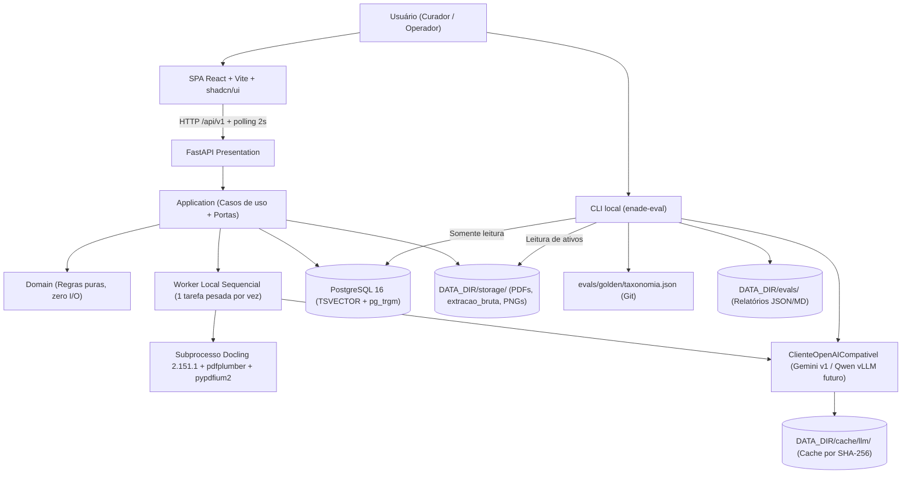
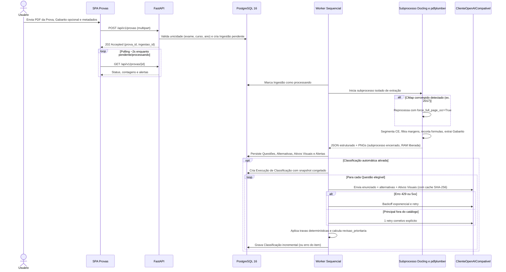
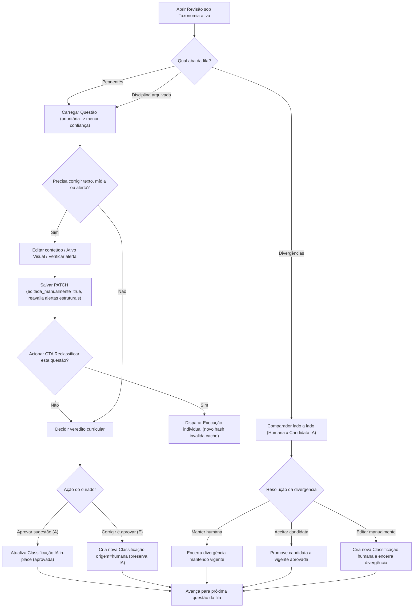
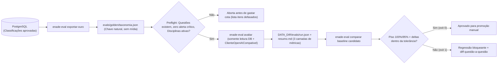

# Explicação Técnica — Enade Questões (v1)

Status: **proposto** (especificação completa fechada na fase de planejamento; nenhum código de produção foi implementado ainda — existem apenas os dois protótipos descartáveis validados em `prototypes/`).

Pedido e critérios da fase: [task.md](task.md) · Mapa de decisões: [mapa.md](mapa.md) · Plano e tarefas: [plano.md](plano.md) · Glossário: [GLOSSARY.md](../../GLOSSARY.md).

Legenda das afirmações: **[protótipo]** comportamento medido nos protótipos executáveis em `prototypes/`; **[pesquisa]** fato levantado em fontes primárias em `pesquisas/`; **[proposto]** comportamento arquitetural e funcional aprovado nos tickets de decisão em `decisoes/`, ainda não implementado no código de produção.

## Contexto e sistema anterior

Não havia aplicação anterior; trata-se de um sistema novo (v1) voltado inicialmente para provas objetivas do Componente Específico do **ENADE de Engenharia de Computação**, com núcleo agnóstico de curso, `Taxonomia` e provedor de LLM **[proposto]**.

Evidências já coletadas antes da implementação:
- 3 edições oficiais completas do INEP em `data/enade/{2017,2019,2023}/` (total de 83 questões objetivas do Componente Específico: 27 em 2017, 27 em 2019, 29 em 2023) **[protótipo]** ([decisão 01](decisoes/01-obter-provas-gabaritos-enade.md)).
- Extração validada em [prototypes/05-extracao-pdf/run_prototype.py](../../prototypes/05-extracao-pdf/run_prototype.py): Docling 2.151.1 (`38 s` / `2,28 GB` RSS em 40 páginas, 29/29 questões segmentadas, 2 colunas preservadas e fallback `force_full_page_ocr` para CMap corrompido de 2017) + `pdfplumber` (3/3 gabaritos em `< 100 ms`) **[protótipo]** ([decisão 05](decisoes/05-prototipar-extracao-prova-real.md)).
- Classificação multimodal validada em [prototypes/07-classificacao-llm/run_prototype.py](../../prototypes/07-classificacao-llm/run_prototype.py): 48/48 respostas válidas em `json_schema` estrito, 100% de aderência aos catálogos ENADE (18 disciplinas) e PPC (9 disciplinas), 3/3 estabilidade em `temperature=0`, ganho comprovado do envio multimodal de imagens (~202–244 tokens/imagem) e constatação empírica de superconfiança do LLM (`0,90–0,99`) **[protótipo]** ([decisão 07](decisoes/07-estrategia-classificacao-e-reclassificacao.md)).

## Arquitetura proposta (visão geral)

A aplicação é organizada em monorepo local com execução nativa de `backend/` (Python 3.13 + `uv` + FastAPI) e `frontend/` (React + TypeScript + Vite + Tailwind + shadcn/ui + `pnpm`), apoiados por **PostgreSQL 16** em `compose.yaml` e armazenamento local organizado em `DATA_DIR` **[proposto]** ([decisão 08](decisoes/08-arquitetura-e-simplificacao-stack.md)).

### Participantes principais

| Componente | Responsabilidade | Referência |
|---|---|---|
| SPA Web (`frontend/`) | 4 seções (`Questões`, `Revisão`, `Provas`, `Taxonomias`), seletor global de `Taxonomia`, pílula do worker via polling (~2 s) e renderização Markdown GFM + KaTeX sanitizada | [decisão 09](decisoes/09-fluxos-interface-web-revisao-consulta.md), [decisão 10](decisoes/10-tratamento-edicao-midia-e-casos-borda.md) |
| API FastAPI (`presentation/`) | Contratos `/api/v1/...`, validação HTTP Pydantic, geração do schema OpenAPI para `openapi-typescript` | [decisão 08](decisoes/08-arquitetura-e-simplificacao-stack.md) |
| Núcleo (`domain/` + `application/`) | Entidades dos 16 termos canônicos, regras determinísticas (alertas, travas pós-LLM, divergências, métricas), casos de uso, portas (`Protocol`) e worker local sequencial | [decisão 06](decisoes/06-modelo-de-dominio-e-glossario.md), [decisão 08](decisoes/08-arquitetura-e-simplificacao-stack.md) |
| Adaptadores (`infrastructure/`) | Docling 2.151.1 em subprocesso isolado, `pdfplumber`, `pypdfium2`, `ClienteOpenAICompativel`, SQLAlchemy 2 + PostgreSQL 16 e `ArmazenamentoArquivos` em `DATA_DIR` | [decisão 05](decisoes/05-prototipar-extracao-prova-real.md), [decisão 07](decisoes/07-estrategia-classificacao-e-reclassificacao.md), [decisão 08](decisoes/08-arquitetura-e-simplificacao-stack.md) |
| CLI `enade-eval` | Exportação do `Conjunto-Ouro`, `Avaliação de Classificação` somente-leitura, comparação com gate de regressão e auditoria passiva IA × Humano | [decisão 11](decisoes/11-metricas-qualidade-e-conjunto-ouro.md) |

### Diagrama de componentes (proposto)

## Fluxo 1 — `Ingestão` de `Prova` e `Execução de Classificação` encadeada (proposto)

- **Gatilho**: envio do formulário na seção `Provas` (`POST /api/v1/provas`) com PDF da `Prova`, PDF opcional de `Gabarito`, metadados `(exame, curso, ano)`, faixa de questões do Componente Específico e opção *"Classificar automaticamente ao concluir"* **[proposto]**.
- **Etapas e falhas relevantes**:
  1. API valida unicidade `(exame, curso, ano)`, salva os PDFs em `DATA_DIR/storage/provas/{prova_id}/`, registra a `Ingestão` como `pendente` no PostgreSQL e responde `202 Accepted`.
  2. O worker local sequencial executa a extração da `Prova` em subprocesso isolado (detectando CMap corrompido para acionar `force_full_page_ocr=True`), trunca antes de `QUESTIONÁRIO DE PERCEPÇÃO`, filtra barcodes/logos de margem, recorta `formula_nao_decodificada` via `pypdfium2` (`origem = formula_recorte`), extrai o `Gabarito` via `pdfplumber` e calcula os `Alerta de Extração`s.
  3. Ao encerrar o subprocesso, toda a RAM do PyTorch (~2,3 GB) retorna ao SO; `Questão`s, `Alternativa`s, `Ativo Visual`s e `Alerta de Extração`s ficam persistidos mesmo que a etapa de LLM falhe depois.
  4. Se a classificação automática estiver marcada, o worker inicia uma `Execução de Classificação` com snapshot congelado da `Taxonomia` e do `Perfil de Classificação`, processando questão a questão com cache em disco, rate-limiting (`LLM_MAX_RPM`), backoff em `429/5xx`, 1 retry corretivo em alucinação da principal e cálculo determinístico de `revisao_prioritaria`.
  5. Em caso de queda/reinício do backend, tarefas deixadas em `processando` são marcadas como `interrompida` no boot para retomada segura sem perder progresso salvo.

## Fluxo 2 — Revisão humana, edição de conteúdo/mídia e triagem de `Divergência de Reclassificação` (proposto)

- **Gatilho**: curador acessa a seção `Revisão` (ou clica em *"Revisar este recorte (N)"* em `Questões`) sob a `Taxonomia` ativa no cabeçalho global **[proposto]**.
- **Comportamento esperado**:
  - Fila dividida em 3 abas: **`Pendentes`** (`revisao_prioritaria` → menor `confianca` → `ano desc, numero asc`), **`Divergências`** (comparador lado a lado Vigente humana × Candidata IA) e **`Disciplina arquivada`**.
  - Na coluna esquerda (~60%), o curador lê a `Questão` renderizada em Markdown GFM + KaTeX sanitizado, amplia `Ativo Visual`s em lightbox e pode abrir a página original do PDF (`pypdfium2`).
  - Se detectar erro do parser, ativa **"Editar conteúdo"** para corrigir enunciado, `Alternativa`s `A`–`E`, `Gabarito` individual ou gerir `Ativo Visual`s (`upload_manual`, substituição, vínculo à alternativa, exclusão) e verificar alertas de inspeção (`pdf_via_ocr`, `fonte_symbol_detectada`). Salvar marca `editada_manualmente = true`, reavalia automaticamente os 4 alertas estruturais e **não** chama o LLM automaticamente — exibe CTA explícito *"Reclassificar esta questão"*.
  - Na coluna direita (~40%), aprovar sem mudanças atualiza a `Classificação` da IA in-place (`pendente_revisao → aprovada`); corrigir cria uma nova `Classificação` (`origem = humana`) preservando intacta a predição original da IA; na aba `Divergências`, escolhe entre `manter_humana`, `aceitar_candidata` ou `editar_manualmente` (transação atômica).

## Fluxo 3 — Reprocessamento seguro e atualização independente de `Gabarito` (proposto)

- **Atualizar `Gabarito`** (`PUT /api/v1/provas/{id}/gabarito`): executa `pdfplumber`, pareia por `numero` oficial, atualiza `situacao_gabarito` (`valida | anulada | pendente`) e `alternativa_correta`, retorna diff (*mantidas / alteradas / anuladas*) e preserva 100% das `Classificação`s e edições de texto **[proposto]**.
- **Reprocessar `Prova`** (`POST /api/v1/provas/{id}/reprocessar`): exige confirmação na UI e reconcilia por `numero` oficial; por padrão (`sobrescrever_editadas = false`), pula `Questão`s com `editada_manualmente = true`, atualizando apenas as não editadas sem apagar `Classificação`s nem `Gabarito` vinculados **[proposto]**.

## Fluxo 4 — `Avaliação de Classificação` offline (`enade-eval`) e migração `Qwen/vLLM` (proposto)

- **Gatilho**: desenvolvedor/operador executa o CLI local `enade-eval` antes de promover um novo `Perfil de Classificação` ou migrar o provedor para `Qwen/vLLM` **[proposto]** ([decisão 11](decisoes/11-metricas-qualidade-e-conjunto-ouro.md)).
- **Isolamento**: leitura apenas no PostgreSQL e em `DATA_DIR/storage/`; nunca grava `Execução de Classificação`, `Classificação` nem `Divergência de Reclassificação` no banco da aplicação.
- **Critério de aprovação**: piso estrutural duro (`100%` conclusão válida após retry e `>= 95%` na 1ª tentativa) + deltas contra o `baseline` sobre o mesmo snapshot (`acuracia_principal >= baseline`, `macro_f1 >= baseline - 2 p.p.`, `jaccard_secundarias >= baseline - 3 p.p.`; ou tolerâncias de `-2 p.p.` principal / `-5 p.p.` secundárias sob `--modo-migracao`).

## Validação dos diagramas Mermaid

- Ferramenta local de renderização (`mmdc`) não está instalada neste ambiente (verificado via `command -v mmdc`). Seguindo as regras locais, não foram instaladas dependências automaticamente.
- Todos os 4 blocos Mermaid foram revisados estaticamente quanto à sintaxe compatível com GitHub/Obsidian/GFM (`flowchart TD`, `flowchart LR`, `sequenceDiagram`, rótulos com caracteres especiais devidamente entre aspas, sem tags HTML nos rótulos e correspondência direta com os fluxos descritos).
- Limitação registrada: validação visual/renderizada pendente quando houver renderizador Mermaid disponível ou na revisão do repositório.
