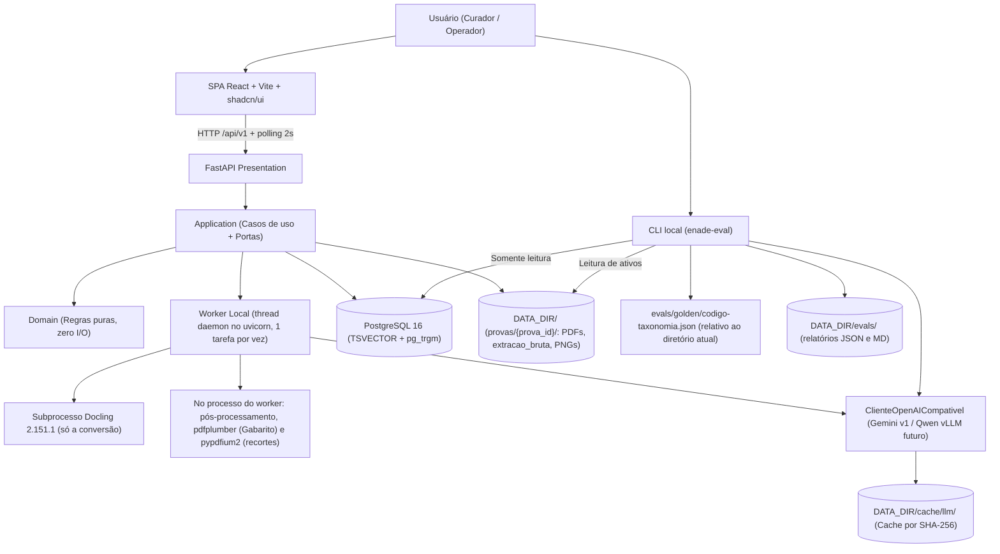
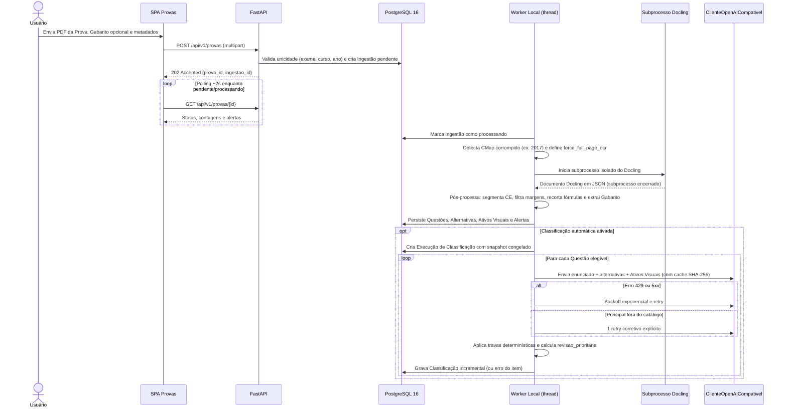
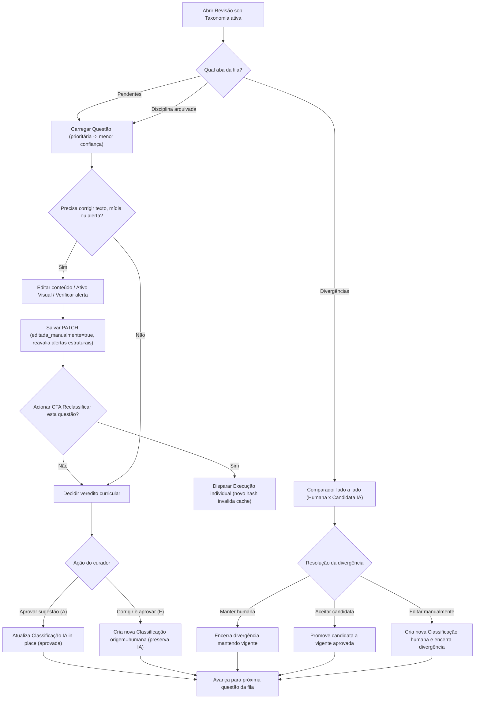
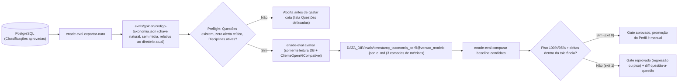

# Explicação Técnica — Enade Questões (v1)

Status: **implementado** (as tarefas 01 a 14 entregaram o código de produção descrito abaixo, com a ressalva de que a Tarefa 10 segue `em andamento`: o victory audit foi interrompido e a pendência está em [validacao.md](validacao.md#pendência-do-victory-audit-da-tarefa-10); este documento foi reconciliado com o código na tarefa 15). A execução real nas 3 provas oficiais e os resultados numéricos estão em [validacao.md](validacao.md); o que depende de confirmação visual ou manual do usuário está marcado como **[aceite manual]**.

Pedido e critérios da fase: [task.md](task.md) · Validação E2E: [validacao.md](validacao.md) · Mapa de decisões: [mapa.md](mapa.md) · Plano e tarefas: [plano.md](plano.md) · Glossário: [GLOSSARY.md](../../GLOSSARY.md).

Legenda das afirmações: **[protótipo]** comportamento medido nos protótipos executáveis em `prototypes/`; **[pesquisa]** fato levantado em fontes primárias em `pesquisas/`; **[implementado]** comportamento presente no código de produção, com referência `arquivo:linha` (caminhos relativos à raiz do repositório; presença e ligação no código, não resultado de execução, que fica em [validacao.md](validacao.md)); **[aceite manual]** comportamento implementado cuja confirmação depende de inspeção visual ou manual do usuário no navegador ou em renderizador Mermaid, ainda pendente.

## Contexto e sistema anterior

Não havia aplicação anterior; trata-se de um sistema novo (v1) voltado inicialmente para provas objetivas do Componente Específico do **ENADE de Engenharia de Computação**, com núcleo agnóstico de curso (o curso é texto livre na ingestão: `backend/src/presentation/api/v1/provas.py:131`; o ENADE de Engenharia de Computação é apenas o seed inicial: `backend/src/application/seed.py:16`), `Taxonomia` e provedor de LLM compatível com a API OpenAI (`backend/src/infrastructure/llm/cliente_openai.py:123`) **[implementado]**.

Evidências já coletadas antes da implementação:
- 3 edições oficiais completas do INEP em `data/enade/{2017,2019,2023}/` (total de 83 questões objetivas do Componente Específico: 27 em 2017, 27 em 2019, 29 em 2023) **[protótipo]** ([decisão 01](decisoes/01-obter-provas-gabaritos-enade.md)).
- Extração validada em [prototypes/05-extracao-pdf/run_prototype.py](../../prototypes/05-extracao-pdf/run_prototype.py): Docling 2.151.1 (`38 s` / `2,28 GB` RSS em 40 páginas, 29/29 questões segmentadas, 2 colunas preservadas e fallback `force_full_page_ocr` para CMap corrompido de 2017) + `pdfplumber` (3/3 gabaritos em `< 100 ms`) **[protótipo]** ([decisão 05](decisoes/05-prototipar-extracao-prova-real.md)).
- Classificação multimodal validada em [prototypes/07-classificacao-llm/run_prototype.py](../../prototypes/07-classificacao-llm/run_prototype.py): 48/48 respostas válidas em `json_schema` estrito, 100% de aderência aos catálogos ENADE (18 disciplinas) e PPC (9 disciplinas), 3/3 estabilidade em `temperature=0`, ganho comprovado do envio multimodal de imagens (~202–244 tokens/imagem) e constatação empírica de superconfiança do LLM (`0,90–0,99`) **[protótipo]** ([decisão 07](decisoes/07-estrategia-classificacao-e-reclassificacao.md)).

## Arquitetura implementada (visão geral)

A aplicação é organizada em monorepo local com execução nativa de `backend/` (Python 3.13 + `uv` + FastAPI) e `frontend/` (React + TypeScript + Vite + Tailwind + shadcn/ui + `pnpm`), apoiados por **PostgreSQL 16** em `compose.yaml` e armazenamento local organizado em `DATA_DIR` (`backend/pyproject.toml:5`, `:9`, `compose.yaml:3`, `backend/src/presentation/main.py:107`) **[implementado]** ([decisão 08](decisoes/08-arquitetura-e-simplificacao-stack.md)).

### Participantes principais

| Componente | Responsabilidade | Referência |
|---|---|---|
| SPA Web (`frontend/`) | 4 seções (`Questões`, `Revisão`, `Provas`, `Taxonomias`), seletor global de `Taxonomia`, pílula do worker via polling (~2 s) e renderização Markdown GFM + KaTeX sanitizada **[implementado]** (`frontend/src/components/layout/SidebarNav.tsx:27-35`, `frontend/src/api/provas.ts:45`) | [decisão 09](decisoes/09-fluxos-interface-web-revisao-consulta.md), [decisão 10](decisoes/10-tratamento-edicao-midia-e-casos-borda.md) |
| API FastAPI (`presentation/`) | Contratos `/api/v1/...`, validação HTTP Pydantic, geração do schema OpenAPI para `openapi-typescript` **[implementado]** (`backend/src/presentation/api/v1/`, `backend/src/presentation/openapi_export.py`) | [decisão 08](decisoes/08-arquitetura-e-simplificacao-stack.md) |
| Núcleo (`domain/` + `application/`) | Entidades dos 16 termos canônicos, regras determinísticas (alertas, travas pós-LLM, divergências, métricas), casos de uso, portas (`Protocol`) e worker local sequencial, executado em uma thread daemon dentro do processo do uvicorn **[implementado]** (`backend/src/application/worker.py:89`, `:145`) | [decisão 06](decisoes/06-modelo-de-dominio-e-glossario.md), [decisão 08](decisoes/08-arquitetura-e-simplificacao-stack.md) |
| Adaptadores (`infrastructure/`) | somente o Docling 2.151.1 roda em subprocesso isolado; `pdfplumber` (Gabarito), `pypdfium2` (recortes e páginas) e o pós-processamento rodam no processo do worker; `ClienteOpenAICompativel`, SQLAlchemy 2 + PostgreSQL 16 e `ArmazenamentoArquivos` em `DATA_DIR` **[implementado]** (`backend/src/infrastructure/extracao/extrator_prova.py:161`, `:225`; `backend/src/infrastructure/extracao/gabarito.py:119`; `backend/src/infrastructure/extracao/renderizador.py:10`) | [decisão 05](decisoes/05-prototipar-extracao-prova-real.md), [decisão 07](decisoes/07-estrategia-classificacao-e-reclassificacao.md), [decisão 08](decisoes/08-arquitetura-e-simplificacao-stack.md) |
| CLI `enade-eval` | Exportação do `Conjunto-Ouro`, `Avaliação de Classificação` somente-leitura, comparação com gate de regressão e auditoria passiva IA × Humano **[implementado]** (`backend/src/presentation/cli/eval_cli.py`, entrypoint em `backend/pyproject.toml`) | [decisão 11](decisoes/11-metricas-qualidade-e-conjunto-ouro.md) |

### Diagrama de componentes

## Fluxo 1 — `Ingestão` de `Prova` e `Execução de Classificação` encadeada

- **Gatilho**: envio do formulário na seção `Provas` (`POST /api/v1/provas`) com PDF da `Prova`, PDF opcional de `Gabarito`, metadados `(exame, curso, ano)`, faixa de questões do Componente Específico e opção *"Classificar automaticamente ao concluir"* **[implementado]** (`backend/src/presentation/api/v1/provas.py:131`, `frontend/src/features/provas/IngestaoFormDialog.tsx`).
- **Etapas e falhas relevantes**:
  1. API valida unicidade `(exame, curso, ano)`, salva os PDFs em `DATA_DIR/provas/{prova_id}/` (sem subpasta `storage/`), registra a `Ingestão` como `pendente` no PostgreSQL e responde `202 Accepted` **[implementado]** (`backend/src/application/provas.py:204`, `:205`, `:230`; `backend/src/presentation/api/v1/provas.py:133`).
  2. O worker local (thread daemon) detecta CMap corrompido (`backend/src/infrastructure/extracao/extrator_prova.py:178`) para acionar `force_full_page_ocr=True` (`backend/src/infrastructure/extracao/_worker.py:30`) e executa **somente a conversão do Docling** em subprocesso isolado (`backend/src/infrastructure/extracao/extrator_prova.py:225`). No processo do worker, o pós-processamento (`backend/src/infrastructure/extracao/extrator_prova.py:189`) trunca antes de `QUESTIONÁRIO DE PERCEPÇÃO` (`backend/src/infrastructure/extracao/posprocessamento.py:29`), filtra barcodes/logos de margem (`backend/src/infrastructure/extracao/posprocessamento.py:176`) e recorta, via `pypdfium2`, as fórmulas não decodificadas como `Ativo Visual` com `origem = formula_recorte` (`backend/src/infrastructure/extracao/posprocessamento.py:441`, `backend/src/domain/enums.py:35`); `formula_recorte` é origem de `Ativo Visual`, não código de alerta. O `Gabarito` é extraído via `pdfplumber` (`backend/src/application/worker.py:363`) e os `Alerta de Extração`s são calculados em `backend/src/domain/alertas_extracao.py:116` **[implementado]**.
  3. Ao encerrar o subprocesso do Docling, a RAM do PyTorch (~2,3 GB medidos no protótipo **[protótipo]**) deve retornar ao SO; o código não instrumenta memória, e a medição por ingestão real fica em [validacao.md](validacao.md). `Questão`s, `Alternativa`s, `Ativo Visual`s e `Alerta de Extração`s ficam persistidos mesmo que a etapa de LLM falhe depois **[implementado]** (`backend/src/application/worker.py:441`, `:487`).
  4. Se a classificação automática estiver marcada, o worker inicia uma `Execução de Classificação` com snapshot congelado da `Taxonomia` e do `Perfil de Classificação`, processando questão a questão com cache em disco, rate-limiting (`LLM_MAX_RPM`), backoff em `429/5xx`, 1 retry corretivo em alucinação da principal e cálculo determinístico de `revisao_prioritaria` **[implementado]** (`backend/src/application/worker.py:487`; `backend/src/application/classificacao.py:380`; `backend/src/infrastructure/llm/cliente_openai.py:198`, `:222`; `backend/src/domain/travas_classificacao.py:42`).
  5. Em caso de queda/reinício do backend, tarefas deixadas em `processando` são marcadas como `interrompida` no boot para retomada segura sem perder progresso salvo **[implementado]** (`backend/src/application/worker.py:142`, `:217`).

## Fluxo 2 — Revisão humana, edição de conteúdo/mídia e triagem de `Divergência de Reclassificação`

- **Gatilho**: curador acessa a seção `Revisão` (ou clica em *"Revisar este recorte (N)"* em `Questões`) sob a `Taxonomia` ativa no cabeçalho global **[implementado]** (`frontend/src/features/questoes/QuestoesPage.tsx:149`).
- **Comportamento implementado**:
  - Fila dividida em 3 abas: **`Pendentes`** (`revisao_prioritaria` → menor `confianca` → `ano desc, numero asc`; a confiança só ordena quando há `Taxonomia`: `backend/src/infrastructure/persistence/consulta_questoes.py:139-145`), **`Divergências`** (comparador lado a lado Vigente humana × Candidata IA) e **`Disciplina arquivada`**.
  - Na coluna esquerda (~60%), o curador lê a `Questão` renderizada em Markdown GFM + KaTeX sanitizado, amplia `Ativo Visual`s em lightbox e pode abrir a página original do PDF (`pypdfium2`: `backend/src/presentation/api/v1/provas.py:262`, `frontend/src/features/revisao/edicao/VisualizadorPdfPagina.tsx:26`) **[implementado]**. A proporção ~60/40 (`frontend/src/features/revisao/RevisaoPage.tsx:540`) e o lightbox **[aceite manual]**.
  - Se detectar erro do parser, ativa **"Editar conteúdo"** para corrigir enunciado, `Alternativa`s `A`–`E`, `Gabarito` individual ou gerir `Ativo Visual`s (`upload_manual`, substituição, vínculo à alternativa, exclusão) e verificar Alertas de Extração (`pdf_via_ocr`, `fonte_symbol_detectada`). Salvar marca `editada_manualmente = true`, reavalia automaticamente os 4 alertas estruturais e **não** chama o LLM automaticamente — exibe CTA explícito *"Reclassificar esta questão"* **[implementado]** (`backend/src/application/questoes.py:355`, `backend/src/domain/alertas_extracao.py:157`, `backend/src/domain/prova.py:34`, `frontend/src/features/revisao/edicao/BannerReclassificacao.tsx:63`).
  - Na coluna direita (~40%), aprovar sem mudanças atualiza a `Classificação` da IA in-place (`pendente_revisao → aprovada`: `backend/src/application/revisao.py:91`, `backend/src/presentation/api/v1/questoes.py:345`); corrigir cria uma nova `Classificação` (`origem = humana`) preservando intacta a predição original da IA (`backend/src/application/revisao.py:120`, `backend/src/domain/classificacao.py:474`, `:540`); na aba `Divergências`, escolhe entre `manter_humana`, `aceitar_candidata` ou `editar_manualmente` (resolução em transação única: `backend/src/application/revisao.py:159`, `backend/src/infrastructure/persistence/repositorios.py:1733`) **[implementado]**. Botões da UI: *Aprovar sugestão* e, para corrigir, *Corrigir e aprovar* (quando a Classificação vigente está `pendente_revisao`) ou *Salvar classificação* (nos demais casos), conforme `frontend/src/features/revisao/PainelVeredito.tsx:66`. Fluxo visual completo **[aceite manual]**.

## Fluxo 3 — Reprocessamento seguro e atualização independente de `Gabarito`

- **Atualizar `Gabarito`** (`PUT /api/v1/provas/{id}/gabarito`): executa `pdfplumber`, pareia por `numero` oficial, atualiza `situacao_gabarito` (`valida | anulada | pendente`) e `alternativa_correta`, retorna diff (*mantidas / alteradas / anuladas*) e preserva as `Classificação`s e edições de texto **[implementado]** (`backend/src/presentation/api/v1/provas.py:210`; `backend/src/application/provas.py:356`; a preservação é verificada por teste de integração e pela E2E em [validacao.md](validacao.md)).
- **Reprocessar `Prova`** (`POST /api/v1/provas/{id}/reprocessar`): exige confirmação na UI e reconcilia por `numero` oficial; por padrão (`sobrescrever_editadas = false`), pula `Questão`s com `editada_manualmente = true`, atualizando apenas as não editadas sem apagar `Classificação`s nem `Gabarito` vinculados **[implementado]** (`backend/src/presentation/api/v1/provas.py:236`, `:252`; `backend/src/domain/reprocessamento.py:147`; `frontend/src/features/provas/ReprocessarProvaDialog.tsx:44`).

## Fluxo 4 — `Avaliação de Classificação` offline (`enade-eval`) e migração `Qwen/vLLM`

- **Gatilho**: desenvolvedor/operador executa o CLI local `enade-eval` antes de promover um novo `Perfil de Classificação` ou migrar o provedor para `Qwen/vLLM` **[implementado]** (`backend/src/presentation/cli/eval_cli.py`; a promoção de Perfil é decisão humana **[aceite manual]**) ([decisão 11](decisoes/11-metricas-qualidade-e-conjunto-ouro.md)).
- **Isolamento**: o banco é aberto em modo somente leitura (`backend/src/infrastructure/persistence/database.py:15`); o CLI nunca grava `Execução de Classificação`, `Classificação` nem `Divergência de Reclassificação`. Grava apenas arquivos: relatórios em `DATA_DIR/evals/` e cache do LLM em `DATA_DIR/cache/llm/`, com uma exceção: `exportar-ouro` sem `--saida` grava em `evals/golden/` relativo ao diretório atual (`backend/src/presentation/cli/eval_cli.py:253`) **[implementado]**.
- **Saídas**: relatórios `DATA_DIR/evals/<timestamp>_<taxonomia>_<perfil>@<versao>_<modelo>.json` e `.md` (`backend/src/application/avaliacao.py:651`-`:672`); `exportar-ouro` grava por padrão em `evals/golden/<taxonomia>.json` relativo ao diretório atual (`backend/src/presentation/cli/eval_cli.py:249`) e o padrão do `make golden-export` é o mesmo (`Makefile`); o comando `comparar` encerra com exit 1 quando o gate reprova, por regressão ou por piso estrutural (`backend/src/presentation/cli/eval_cli.py:339-340`) **[implementado]**.
- **Critério de aprovação**: piso estrutural duro (`100%` conclusão válida após retry e `>= 95%` na 1ª tentativa: `backend/src/domain/metricas_avaliacao.py:28`, `:293`) + deltas contra o `baseline` sobre o mesmo snapshot (`acuracia_principal >= baseline`, `macro_f1 >= baseline - 2 p.p.`, `jaccard_secundarias >= baseline - 3 p.p.`; ou tolerâncias de `-2 p.p.` principal / `-5 p.p.` secundárias sob `--modo-migracao`: `backend/src/domain/metricas_avaliacao.py:30`-`:33`, `:304`) **[implementado]**.

## Validação dos diagramas Mermaid

- Os 4 blocos Mermaid foram atualizados para o comportamento implementado e revisados estaticamente (`flowchart TD`, `flowchart LR`, `sequenceDiagram`; rótulos com caracteres especiais entre aspas; sem tags HTML nos rótulos). Nenhum parser Mermaid local foi executado nesta reconciliação (`mmdc` e pacotes Mermaid não estão instalados), portanto a sintaxe foi verificada apenas por leitura. Evidências de execução da tarefa ficam em [validacao.md](validacao.md).
- Sem renderizador local (`mmdc`) disponível neste ambiente, a renderização visual em GitHub/Obsidian **[aceite manual]** permanece pendente de confirmação do usuário.
