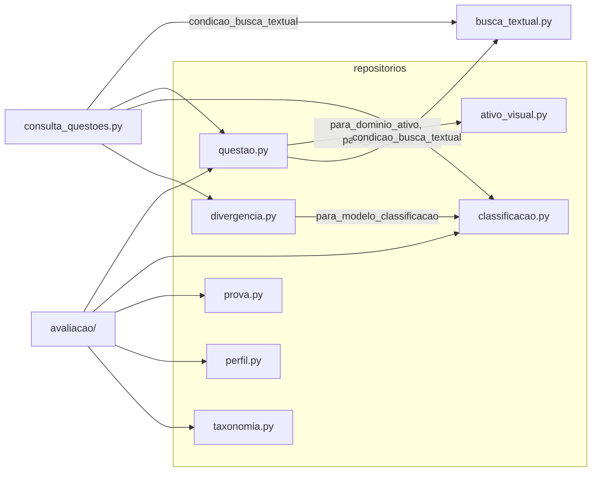

# Explicação — Reorganização dos arquivos do backend

Status: **proposta** (nenhuma tarefa executada; a organização descrita aqui é o alvo).

Pedido: [task.md](task.md) · Plano: [plano.md](plano.md) · Validação: [validacao.md](validacao.md) · Mapa: [mapa.md](mapa.md).

## Contexto

As 4 camadas hexagonais de `backend/src/` (`domain`, `application`, `infrastructure`, `presentation`) separam bem as responsabilidades, mas alguns arquivos concentram vários agregados ou recursos. Em 2026-11-28 (commit `269d957`), 14 arquivos passavam de 400 linhas. O maior era `infrastructure/persistence/repositorios.py`, com 1910 linhas e 9 repositórios. A contagem completa está em [validacao.md](validacao.md#linha-de-base).

A reorganização mantém as camadas no topo, como fixa a [decisão 08 do planejamento inicial](../planejamento-inicial/decisoes/08-arquitetura-e-simplificacao-stack.md), e transforma os arquivos grandes em subpacotes por agregado ou recurso dentro de cada camada. Fatias verticais por contexto foram descartadas (ver [mapa.md](mapa.md#out-of-scope)).

## O que muda e o que não muda

| Muda | Não muda |
|---|---|
| Local dos símbolos de 12 módulos, que viram 10 pacotes | Corpo de classes e funções |
| Um módulo novo: `persistence/busca_textual.py` | Nomes de classes, funções públicas e funções de rota |
| Prefixo `_` dos mapeadores ORM↔domínio e dos serializadores HTTP que passam a ser importados entre submódulos | OpenAPI exportado, incluindo nomes de componentes, `operationId` e ordem de `paths` |
| Imports internos de `consulta_questoes.py` e `persistence/avaliacao/` | Schema de banco e migrações Alembic |
| Referências `arquivo:linha` em `docs/planejamento-inicial/explicacao.md` | Contratos do `import-linter`, `pyproject.toml`, testes e `README.md` |

## Organização-alvo

Só aparecem os arquivos que viram pacote ou módulo novo. Os demais ficam onde estão. A tabela símbolo → submódulo de cada pacote está na decisão da camada.

```text
backend/src/
├── domain/                          # decisão 01
│   ├── prova/                       # era prova.py (481)
│   │   ├── __init__.py
│   │   ├── prova.py                 # Prova, FaixaQuestoes
│   │   ├── ingestao.py              # Ingestao, MetadadosIngestao
│   │   ├── questao.py               # Questao, Alternativa, Gabarito, AtivoVisual, BoundingBox
│   │   ├── alerta_extracao.py       # AlertaExtracao e constantes de severidade
│   │   └── _validacao.py            # validadores privados compartilhados
│   ├── classificacao/               # era classificacao.py (613)
│   │   ├── __init__.py
│   │   ├── perfil.py
│   │   ├── execucao.py
│   │   └── classificacao.py         # inclui DivergenciaReclassificacao
│   └── avaliacao/                   # era avaliacao.py (407)
│       ├── __init__.py
│       ├── conjunto_ouro.py
│       └── avaliacao.py             # inclui os tipos do gate
├── application/                     # decisão 02
│   ├── questoes/                    # era questoes.py (535)
│   │   ├── __init__.py
│   │   ├── consulta.py
│   │   ├── detalhe.py
│   │   ├── edicao.py                # inclui ResolverAlertaExtracaoUseCase
│   │   ├── ativo_visual.py
│   │   └── _apoio.py                # _buscar_questao
│   ├── classificacao/               # era classificacao.py (459)
│   │   ├── __init__.py
│   │   ├── prompt.py                # schema JSON e montagem de prompt
│   │   └── classificacao.py         # ClassificarQuestaoService
│   └── avaliacao/                   # era avaliacao.py (738)
│       ├── __init__.py
│       ├── relatorio.py             # serialização JSON e relatório Markdown
│       ├── avaliacao.py             # exportar, avaliar e comparar
│       └── historico.py
├── infrastructure/persistence/      # decisão 03
│   ├── busca_textual.py             # novo: condicao_busca_textual
│   ├── models/                      # era models.py (526)
│   │   ├── __init__.py              # importa todos os submódulos
│   │   ├── base.py
│   │   ├── prova.py
│   │   ├── taxonomia.py
│   │   └── classificacao.py
│   ├── repositorios/                # era repositorios.py (1910)
│   │   ├── __init__.py              # reexporta as 9 classes Repositorio*SqlAlchemy
│   │   ├── prova.py
│   │   ├── ingestao.py
│   │   ├── questao.py               # exceção aceita (~480)
│   │   ├── ativo_visual.py
│   │   ├── taxonomia.py
│   │   ├── perfil.py
│   │   ├── execucao.py
│   │   ├── classificacao.py
│   │   ├── divergencia.py
│   │   └── _apoio.py                # _agora_utc
│   └── avaliacao/                   # era avaliacao.py (397)
│       ├── __init__.py
│       ├── conjunto_ouro.py
│       └── consulta.py
└── presentation/api/                # decisão 04
    ├── schemas/                     # era schemas.py (303) + schemas_questoes.py (237)
    │   ├── __init__.py
    │   ├── erro.py
    │   ├── health.py
    │   ├── prova.py
    │   ├── taxonomia.py
    │   ├── perfil.py
    │   ├── execucao.py
    │   └── questao.py               # todo o antigo schemas_questoes.py
    └── v1/questoes/                 # era v1/questoes.py (489)
        ├── __init__.py              # router, serializar_ativo
        ├── rotas.py
        └── serializacao.py
```

Fontes do corte: [decisão 01](decisoes/01-corte-domain.md), [decisão 02](decisoes/02-corte-application.md), [decisão 03](decisoes/03-corte-infrastructure.md) e [decisão 04](decisoes/04-corte-presentation.md).

## Regras de import e visibilidade

1. **Caminho antigo continua válido.** O `__init__.py` de cada pacote novo reexporta todos os nomes públicos do módulo antigo, constantes incluídas, com `__all__` explícito. `from domain.prova import Questao` e os demais imports atuais continuam funcionando. Há duas exceções, ambas internas:
   - `condicao_busca_textual` sai de `repositorios` e passa a ser importada de `infrastructure.persistence.busca_textual`.
   - `presentation.api.schemas_questoes` é apagado. Seus nomes passam a vir de `presentation.api.schemas`.
2. **Dentro do pacote, import direto.** Os submódulos importam uns aos outros pelo caminho do submódulo, por exemplo `from domain.classificacao.perfil import PerfilClassificacao`, e nunca pelo `__init__.py` do próprio pacote. Isso evita ciclos de import na carga do pacote.
3. **Privados ficam perto de quem usa.** O helper usado por um só submódulo vai junto dele. O helper usado por dois ou mais submódulos do mesmo pacote vai para `_validacao.py` (em `domain/`) ou `_apoio.py` (nas outras camadas), e não é reexportado. As duplicatas entre pacotes, como as cópias de `_agora_utc`, ficam como estão.
4. **Mapeadores e serializadores compartilhados ficam públicos no dono.** Um mapeador ORM↔domínio usado fora do seu submódulo perde o `_` e fica no submódulo do repositório do agregado dono, sem reexportação no `__init__.py`. Exemplo: `para_dominio_questao` em `repositorios/questao.py`, importado por `consulta_questoes.py`. O mesmo vale para os serializadores de `v1/questoes/serializacao.py`, importados por `rotas.py`.
5. **`import-linter` inalterado.** Os 3 contratos atuais continuam valendo, e não entram contratos novos entre subpacotes.

### Dependências dentro de `persistence/` depois da tarefa 08

O diagrama mostra os imports entre submódulos que aparecem por causa do corte. Os imports de `models/`, `domain/` e `application.ports` não aparecem.



Hoje `consulta_questoes.py` importa `_para_dominio_classificacao`, `_para_dominio_divergencia`, `_para_dominio_questao` e `condicao_busca_textual` de `repositorios`. `persistence/avaliacao.py` importa `_para_dominio_classificacao`, `_para_dominio_perfil`, `_para_dominio_prova`, `_para_dominio_questao` e `_para_dominio_taxonomia`. Depois da tarefa 08, cada mapeador vem, sem o `_`, do submódulo dono. `_agora_utc` fica em `repositorios/_apoio.py`, usado por 6 submódulos, e não aparece no diagrama.

## Exceções aceitas ao teto de cerca de 400 linhas

Depois da tarefa 11, só estes arquivos podem passar de 400 linhas:

| Arquivo | Linhas | Motivo |
|---|---|---|
| `application/worker.py` | 559 | Classe única `WorkerLocal`. Tirar os auxiliares deixaria o arquivo com cerca de 515 linhas e exigiria reexportar o privado `_SENTINELA_PARAR`, importado por um teste |
| `infrastructure/llm/cliente_openai.py` | 526 | Classe única `ClienteOpenAICompativel`. Tirar os auxiliares deixaria cerca de 435 linhas e tornaria públicos 4 privados |
| `infrastructure/persistence/repositorios/questao.py` | ~480 | Só `RepositorioQuestoesSqlAlchemy` tem 399 linhas |
| `infrastructure/extracao/posprocessamento.py` | 471 | Pipeline único orquestrado por `posprocessar_elementos` |
| `application/provas.py` | 434 | Um agregado. Virar pacote quebraria o `monkeypatch` de `aplicar_gabarito_na_prova` em `tests/integration/test_concorrencia_sistema.py` |
| `application/execucoes_classificacao.py` | 412 | Um agregado, cerca de 12 linhas acima do teto |

Classes grandes não são divididas neste esforço. Isso seria mudança de design ([mapa.md](mapa.md#out-of-scope)).
